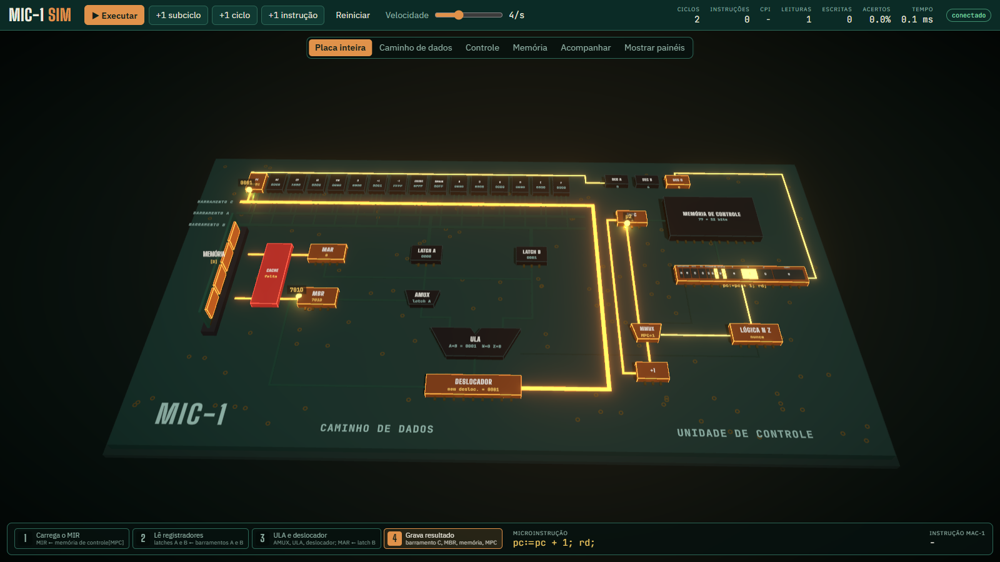
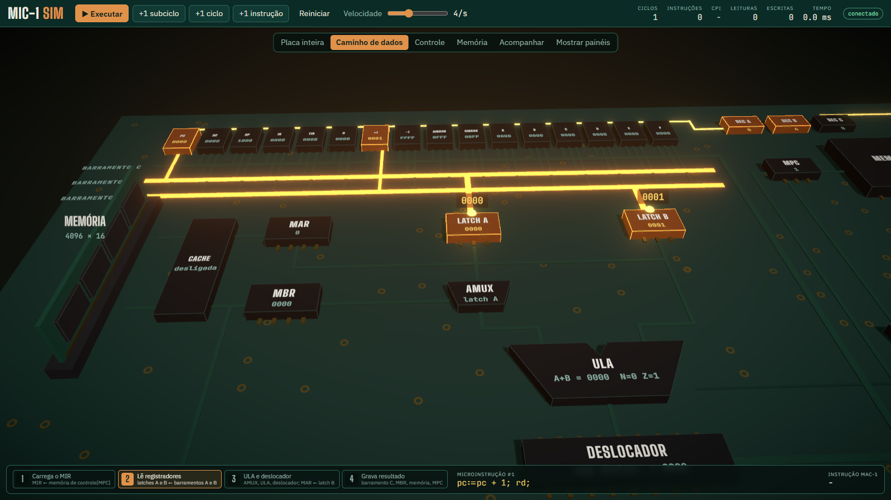
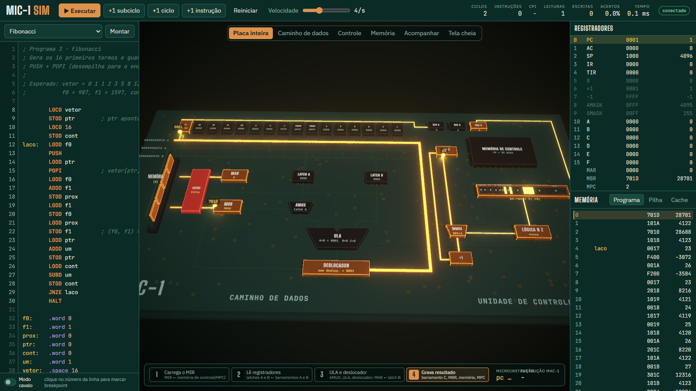
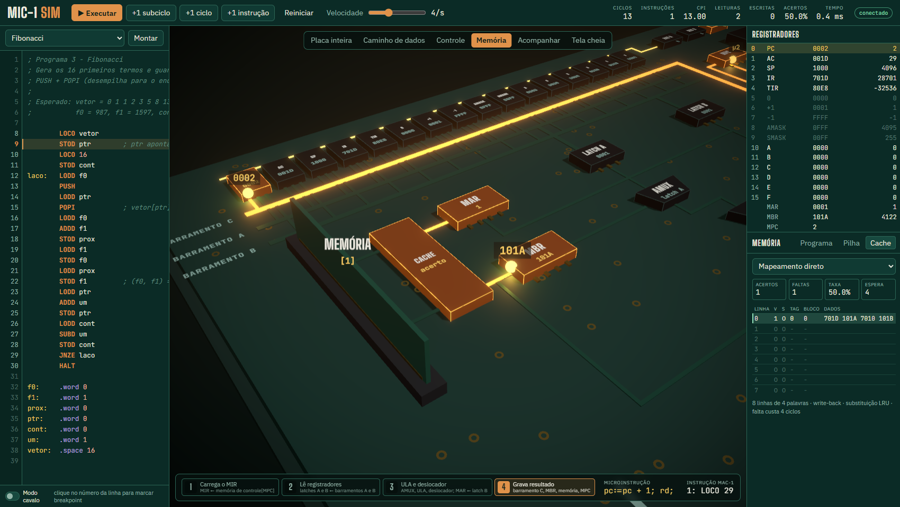

<div align="center">

# MIC-1 Sim

**Simulador do MIC-1 com o caminho de dados em 3D**




</div>

O MIC-1 é a máquina microprogramada de 16 bits do livro *Organização Estruturada de
Computadores*, do Tanenbaum. Este simulador executa o microprograma original de 79
microinstruções, que interpreta o conjunto de instruções MAC-1, e mostra cada ciclo de clock
acontecendo numa placa em 3D: os registradores sendo lidos pelos barramentos A e B, a ULA
calculando, o resultado voltando pelo barramento C e a memória respondendo dois ciclos
depois do pedido.

Trabalho da disciplina de Arquitetura de Computadores.

## O que dá para fazer

- Escrever um programa em assembly MAC-1, montar e carregar na memória
- Executar subciclo por subciclo, microinstrução por microinstrução ou instrução por instrução
- Ver na placa quais componentes e trilhas estão ativos e os valores passando por elas
- Acompanhar os 16 registradores, MAR, MBR, MPC, os campos do MIR e a memória
- Ligar uma memória cache com mapeamento direto, totalmente associativo ou por conjunto e ver acertos, faltas e os ciclos de espera
- Marcar breakpoints clicando no número da linha
- Ajustar a velocidade, de meio subciclo por segundo até o máximo
- Ver ciclos, instruções, CPI, leituras e escritas na memória e o tempo de execução
- Trocar a câmera entre a placa inteira, o caminho de dados, o controle, a memória e um modo que acompanha a execução sozinho



## Como rodar

Precisa de **Python 3.11+** e **Node.js 20+**.

```bash
git clone https://github.com/Kronohdev/mic1-sim.git
cd mic1-sim

# backend
cd backend
python -m venv .venv
.venv\Scripts\activate          # no Linux/macOS: source .venv/bin/activate
pip install -e .

# frontend (compila uma vez)
cd ../frontend
npm install
npm run build

# sobe tudo
cd ../backend
python -m mic1 --abrir
```

O navegador abre em **http://127.0.0.1:8765** com o Fibonacci já carregado.

<details>
<summary>Modo de desenvolvimento (recarrega sozinho ao editar)</summary>

Em dois terminais:

```bash
cd backend && python -m mic1          # servidor na porta 8765
cd frontend && npm run dev            # interface em http://localhost:5173
```

</details>

<details>
<summary>Testes</summary>

```bash
cd backend
pip install -e ".[dev]"
pytest
```

São 52 testes: a codificação do microprograma, cada uma das 23 instruções MAC-1, o montador,
a cache e os programas de exemplo chegando ao mesmo resultado com e sem cache.

</details>

### Atalhos

| Tecla | Ação |
| --- | --- |
| `Ctrl+Enter` | montar |
| `F8` | executar / pausar |
| `F9` | avançar um subciclo |
| `F10` | avançar um ciclo (uma microinstrução) |
| `Shift+F10` | avançar uma instrução MAC-1 |
| `F11` | esconder os painéis e deixar só a placa |

## Como o simulador funciona



O núcleo em Python (`backend/mic1`) modela cada componente do caminho de dados e da unidade
de controle. Cada ciclo é dividido nos 4 subciclos do livro:

| Subciclo | O que acontece |
| :---: | --- |
| 1 | o MIR recebe a microinstrução apontada pelo MPC |
| 2 | os latches A e B recebem os registradores escolhidos pelos campos A e B |
| 3 | AMUX, ULA e deslocador calculam; o MAR pode receber o latch B |
| 4 | o barramento C grava no registrador destino, o MBR pode ser carregado, a memória avança e o MPC recebe o próximo endereço |

A leitura e a escrita na memória levam dois ciclos: o sinal RD (ou WR) tem que ficar ligado em
duas microinstruções seguidas, e o dado só aparece no MBR no fim da segunda. É por isso que o
microprograma tem pares como `mar:=pc; rd;` seguido de `pc:=pc + 1; rd;`.

O microprograma fica escrito em MAL no arquivo [`microcodigo.py`](backend/mic1/microcodigo.py),
do mesmo jeito que aparece no livro, e um pequeno montador de MAL gera as 79 palavras de 32 bits
da memória de controle quando o programa inicia.

O frontend (React + three.js) não calcula nada da simulação. Ele recebe pelo WebSocket o estado
completo depois de cada subciclo e desenha. Detalhes em [docs/arquitetura.md](docs/arquitetura.md)
e [docs/protocolo.md](docs/protocolo.md).

### Memória cache

A cache fica entre o MAR/MBR e a memória principal e pode ser ligada na aba **Cache** do
painel de memória. São 8 linhas de 4 palavras, com três organizações:

| Mapeamento | Onde um bloco pode ficar |
| --- | --- |
| Direto | numa única linha, escolhida pelo endereço |
| Totalmente associativo | em qualquer uma das 8 linhas |
| Associativo por conjunto | em qualquer uma das 2 linhas do seu conjunto (4 conjuntos) |

A escrita é **write-back**: o valor fica só na cache, marcado como sujo, e vai para a memória
quando a linha é substituída ou quando o programa termina. A substituição é **LRU** (sai a linha
usada há mais tempo). Um acerto não custa nada além dos 2 ciclos normais; uma falta custa 4
ciclos de espera, mais 4 se for preciso devolver uma linha suja. Durante a espera o caminho de
dados fica parado e a placa mostra o bloco vindo da memória.



Taxa de acerto nos programas de exemplo:

| Programa | Direto | Associativo | Por conjunto |
| --- | :---: | :---: | :---: |
| Aritmética | 76,9% | 76,9% | 76,9% |
| Soma de 1 a N | 97,4% | 97,4% | 97,4% |
| Fibonacci | 90,0% | 83,2% | 86,6% |
| Sub-rotina | 94,3% | 94,3% | 94,3% |
| Vetor | 87,7% | 79,8% | 84,0% |

No Fibonacci e no vetor a cache totalmente associativa fica atrás da direta. O laço usa mais
blocos do que cabem nas 8 linhas, e com LRU o bloco que sai é justamente o que vai ser usado de
novo logo em seguida. No mapeamento direto alguns blocos nunca disputam a mesma linha e ficam
na cache o tempo todo.

### Formato da microinstrução

```text
 31   30-29  28-27  26-25  24   23   22   21   20   19-16  15-12  11-8   7-0
AMUX  COND   ALU    SH     MBR  MAR  RD   WR   ENC  C      B      A      ADDR
```

| Campo | Valores |
| --- | --- |
| AMUX | 0 = latch A, 1 = MBR |
| COND | 0 = não desvia, 1 = desvia se N, 2 = desvia se Z, 3 = sempre desvia |
| ALU | 0 = A + B, 1 = A AND B, 2 = A, 3 = NOT A |
| SH | 0 = sem deslocamento, 1 = 1 bit à direita, 2 = 1 bit à esquerda |
| C, B, A | número do registrador (0 = PC, 1 = AC, 2 = SP, ... 15 = F) |

## Montador MAC-1

```asm
; comentarios com ; ou #
        LOCO 16
        STOD cont           ; variavel declarada la embaixo
laco:   LODD cont
        SUBD um
        STOD cont
        JNZE laco
        HALT                ; vira JUMP para o proprio endereco

cont:   .word 0
um:     .word 1
vetor:  .space 8            ; 8 palavras zeradas
```

- Rótulos com `nome:`, na mesma linha da instrução ou sozinhos
- Números em decimal ou hexadecimal (`0x1F`); `.word` aceita negativos e listas
- Nomes usados em `LODD`, `STOD`, `ADDD` e `SUBD` que não foram declarados viram variáveis automáticas, alocadas depois do programa
- `HALT` não existe no MAC-1 original: o montador gera um `JUMP` para o próprio endereço, e o simulador para quando encontra esse laço
- Os erros mostram a linha e o motivo, por exemplo `linha 7: LOCO aceita de 0 a 4095, recebeu 5000`

| Instrução | Significado | | Instrução | Significado |
| --- | --- | --- | --- | --- |
| `LODD x` | AC = M[x] | | `JNEG x` | se AC < 0, vai para x |
| `STOD x` | M[x] = AC | | `JNZE x` | se AC ≠ 0, vai para x |
| `ADDD x` | AC = AC + M[x] | | `CALL x` | empilha PC, vai para x |
| `SUBD x` | AC = AC - M[x] | | `PSHI` | empilha M[AC] |
| `JPOS x` | se AC ≥ 0, vai para x | | `POPI` | M[AC] = desempilha |
| `JZER x` | se AC = 0, vai para x | | `PUSH` | empilha AC |
| `JUMP x` | vai para x | | `POP` | AC = desempilha |
| `LOCO c` | AC = c (0 a 4095) | | `RETN` | PC = desempilha |
| `LODL d` | AC = M[SP + d] | | `SWAP` | troca AC e SP |
| `STOL d` | M[SP + d] = AC | | `INSP n` | SP = SP + n (0 a 255) |
| `ADDL d` | AC = AC + M[SP + d] | | `DESP n` | SP = SP - n (0 a 255) |
| `SUBL d` | AC = AC - M[SP + d] | | | |

A pilha começa em 4096, então o primeiro `PUSH` grava no endereço 4095.

## Cavalês 🐴

O montador também entende um dialeto com nomes do mundo dos cavalos. Ele é só uma troca de
nomes antes da montagem: o código de máquina gerado é idêntico ao do MAC-1 normal.

<table>
<tr><th>MAC-1</th><th>Cavalês</th></tr>
<tr><td>

```asm
laco:   LODD f0
        PUSH
        LODD ptr
        POPI
        ...
        JNZE laco
        HALT
```

</td><td>

```asm
laco:   pasta f0
        enfarda
        pasta ptr
        desenfarda_no_pasto
        ...
        segue_trote laco
        relincha
```

</td></tr>
</table>

A tabela completa está em [docs/cavales.md](docs/cavales.md). No simulador, o **Modo cavalo**
mostra a instrução em execução em cavalês.

## Programas de exemplo

| Programa | Mostra | Resultado |
| --- | --- | --- |
| [`01_aritmetica.asm`](programs/01_aritmetica.asm) | `LODD`, `ADDD`, `SUBD`, `STOD` | soma = 42, dif = 8 |
| [`02_laco_soma.asm`](programs/02_laco_soma.asm) | laço com `JNEG` | 1 + 2 + ... + 10 = 55 |
| [`03_fibonacci.asm`](programs/03_fibonacci.asm) | vetor com `PUSH` + `POPI` | 0 1 1 2 3 5 ... 610 |
| [`04_subrotina.asm`](programs/04_subrotina.asm) | `CALL`, `RETN`, `LODL`, `STOL`, `INSP` | 6 × 7 = 42 |
| [`05_vetor.asm`](programs/05_vetor.asm) | leitura indireta com `PSHI` | soma = 26, maior = 12 |
| [`06_fibonacci.cav`](programs/06_fibonacci.cav) | cavalês | igual ao 03 |

O cabeçalho de cada arquivo traz a entrada, o resultado esperado e o estado final.

## Estrutura

```text
backend/
  mic1/
    microcodigo.py   microprograma em MAL e o montador de MAL
    maquina.py       caminho de dados e controle, subciclo a subciclo
    cache.py         cache com os tres mapeamentos, write-back e LRU
    montador.py      montador MAC-1 (e cavales)
    api.py           servidor WebSocket
  tests/
frontend/
  src/
    placa/           cena 3D: layout da placa, chips, trilhas, pacotes de dados
    painel/          editor, registradores, memoria
programs/            programas de exemplo
docs/                arquitetura, protocolo, cavales
```

## Equipe

| | |
| --- | --- |
| **Kauã Neves** | arquitetura, integração e memória cache |
| **Pedro Leite** | caminho de dados e unidade de controle |
| **Gabriel Estrella** | montador MAC-1 e cavalês |
| **Gabriel Alves** | interface e placa 3D |

## Referências

- A. S. Tanenbaum, *Organização Estruturada de Computadores*, capítulo 4 (o MIC-1 e o microprograma do MAC-1)
- [SimuladorVinod](https://github.com/csbassin/SimuladorVinod) e [Mic-I-Simulador-ARQ](https://github.com/gabrielnascimentogarcia/Mic-I-Simulador-ARQ), simuladores de outras turmas que usamos para conferir o microprograma
